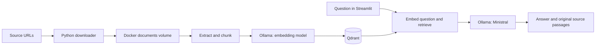

# Digital Sovereignty with Local RAG

A small Python prototype for the SFSCON talk described in [agent.md](agent.md).
It downloads documents, indexes their passages, and answers questions using local
models. The code keeps each step visible so you can learn the pipeline and change
one part at a time.

## The short plan

1. **Download:** save openly licensed source documents in `/app/docs/` inside Docker.
2. **Ingest:** extract text, split it into overlapping chunks, and embed each chunk.
3. **Store:** put embeddings, original text, and source metadata in Qdrant.
4. **Retrieve:** embed a question and find passages with similar vectors.
5. **Answer:** give those passages to Ministral and display its answer with evidence.

The default source is the **Open Definition 2.1**, by Open Knowledge Foundation
and contributors, licensed under [CC BY 4.0](https://creativecommons.org/licenses/by/4.0/).
It is a short, openly licensed document about open knowledge, rather than a tabular
dataset, so the first ingestion is small and questions can be specific.
The [original publication](https://opendefinition.org/od/2.1/en/) and download URL
are recorded in `config/sources.toml` and carried into source references.

## Start the system

You only need Docker Engine or Docker Desktop. Python, models, test tools, and
document downloads stay inside Docker containers and Docker-managed volumes.
The project source and configuration files remain in this directory.

From this directory:

```bash
./compose up --build
```

The `compose` script runs the official Docker CLI image with Compose included.
It uses your Docker daemon and mounts this project read-only; it installs no host
plugins or Python packages. On Linux it uses `/var/run/docker.sock`. If Compose v2
is already part of your Docker installation, `docker compose up --build` also works.
The commands below use `./compose` so no separate Compose installation is needed.

Wait for the `models` startup job to finish, then open **http://localhost:8501**.
The first startup needs Internet access to download images, Python packages,
and model weights. Later starts reuse the downloaded models.

In the sidebar:

1. Click **1. Download / update documents**.
2. Click **2. Ingest new / changed documents**.
3. Ask a question about the indexed documents.

Try:

- “Must an open license allow redistribution, including sale?”
- “Can an open license require attribution?”
- “What does the definition require for machine readability?”
- “Are you an AI?” — the model can answer directly, without document citations.
- “What is tomorrow's weather in Bolzano?” — the model has no live weather data.

Each question is independent. Conversation history is displayed, but previous
answers are not sent back as evidence. Include the subject in follow-up questions.

Ministral's Ollama download is approximately 3 GB; the embedding model is about
274 MB. Allow additional space for images, the database, and documents. As a
starting estimate, allow at least 8 GB of RAM available to Docker; 16 GB of system
RAM is more comfortable. Actual memory and response time depend on your laptop.
CPU generation may take a while: prepare the corpus before the talk and rehearse
your questions on the actual machine.

## How the pieces fit



| Container | Responsibility |
| --- | --- |
| `web` | Streamlit chat, download controls, ingestion controls, Python pipeline |
| `qdrant` | Vector similarity search and passage metadata |
| `ollama` | Local embedding and language model inference on CPU |
| `models` | One-shot readiness check and download of missing models |

Only the chat port is published, bound to your machine's loopback interface.
Ollama and Qdrant are reached through the Compose network. Qdrant telemetry and
Streamlit usage statistics are disabled; Ollama cloud features are disabled.
The application calls local inference endpoints and sends configured HTTP download
requests when you click Download. Once preparation is complete, you can disconnect
the laptop from the Internet and continue querying without downloading anything.

## Read the code in this order

| File | What to learn |
| --- | --- |
| `compose` | Running Compose itself inside Docker without a host installation |
| `config/settings.toml` | Model names, chunk sizes, retrieval settings, CPU context limits |
| `config/system_prompt.txt` | Editable conversational rules for the local model |
| `config/sources.toml` | Download URLs and document attribution |
| `local_rag/config.py` | Loading and validating TOML configuration |
| `local_rag/download.py` | Streaming downloads and safe replacement of existing files |
| `local_rag/documents.py` | Text extraction and overlapping chunks |
| `local_rag/ollama.py` | Plain HTTP calls for embeddings and constrained JSON generation |
| `local_rag/vector_store.py` | Qdrant collections, payload filters, and vector search |
| `local_rag/ingest.py` | Incremental indexing and document revisions |
| `local_rag/chat.py` | Retrieval, context budget, and source validation |
| `local_rag/state.py` | Atomic manifests and a shared process lock |
| `app.py` | Interface code, separate from the pipeline |
| `local_rag/bootstrap.py` | Waiting for services and preparing models |

An **embedding** is a list of numbers representing a piece of text. Similar
passages usually have similar embeddings. A **chunk** is a small passage from a
document; retrieving chunks keeps the prompt focused. Qdrant stores each chunk's
vector alongside its text, filename, source URL, page number when available,
content hash, and revision. The LLM receives retrieved text, not vectors.

## Add or update documents

The supported formats are UTF-8 `.txt`, `.md`, and text-based `.pdf`. Scanned PDFs
need OCR before ingestion. HTML, office documents, and tables requiring special
parsing are outside this minimal prototype.

To add a remote document, append to `config/sources.toml`:

```toml
[[documents]]
filename = "your-document.pdf"
url = "https://your-organisation.example/documents/your-document.pdf"
title = "Your document title"
attribution = "Document author"
license = "Document license"
reference_url = "https://your-organisation.example/documents/"
```

Use a real direct-download URL and a unique filename. Click Download, then
Ingest. By default, downloading skips files already present. Select **Overwrite
existing downloads** to fetch those URLs again. A failed download keeps the old
file. Downloads are limited to 25 MB each by default.
If you change the URL associated with an existing filename, overwrite that
download before ingestion so the file and its configured source still match.

To add an existing local file, copy it into the running container's document volume:

```bash
./compose cp /path/to/your-document.pdf web:/app/docs/your-document.pdf
```

Then ingest. Local files have filename citations but no remote URL unless they
match a configured source. Use the source configuration for attribution. No
downloaded documents are written into a host `docs/` folder.

Every ingestion:

- Hashes file contents and source metadata to identify changed documents.
- Skips matching revisions whose expected chunk count is still present in Qdrant.
- Generates embeddings before replacing a usable document revision.
- Commits a complete revision in an atomic manifest; retrieval excludes uncommitted revisions.
- Removes outdated chunks and files deleted from `/app/docs/`.
- Continues processing other files when an individual document cannot be read.

Deterministic point IDs make a retry safe without duplicating chunks. A shared
file lock coordinates the web app and CLI: ingestion and downloading serialize,
and questions wait while documents are being changed. It is intended for one
laptop and one Compose deployment.

Files remain indexed until the next ingestion. Removing a URL from the source
configuration does not remove its downloaded file. To remove a document from
retrieval, delete it inside the container and ingest again:

```bash
./compose exec web rm /app/docs/your-document.pdf
./compose exec web python -m local_rag.ingest
```

## Use the scripts directly

The same functions serve the web buttons and command-line scripts:

```bash
./compose exec web python -m local_rag.download
./compose exec web python -m local_rag.download --overwrite
./compose exec web python -m local_rag.ingest
./compose exec web python -m local_rag.ingest --force
```

`--force` regenerates embeddings even for unchanged files. Scripts exit with a
nonzero status if a document fails, and report individual results.

## Configuration and persistent storage

The initial language model is `ministral-3:3b`; the embedding model is
`nomic-embed-text:v1.5`. Both names are defined in `config/settings.toml`.
Nomic's document and question prefixes are configured there as well.

If you change a model, download the new weights and restart the app:

```bash
./compose run --rm models
./compose restart web
```

Then ingest again if you changed the embedding model or chunking. A different
embedding model may require different dimensions and prefixes; change those
settings too. Index identities include the downloaded embedding-model digest,
dimensions, prefixes, chunking settings, and an extraction-format version.
Incompatible embeddings therefore use separate collections. Old collections
remain on disk; switching configurations back can reuse them.

The startup job pulls **missing** models and does not silently refresh installed
tags. Updating an existing tag deliberately is possible with
`./compose exec ollama ollama pull MODEL_NAME`. If embedding weights change,
ingest again. Image versions and direct Python dependencies are pinned; model
tags and transitive Python dependencies are not a complete immutable build lock.

| Docker-managed volume | Contents | Persists after ordinary `./compose down`? |
| --- | --- | --- |
| `documents` named volume | Downloaded and copied documents at `/app/docs/` | Yes |
| `qdrant_data` named volume | Chunks, metadata, and vectors | Yes |
| `ollama_data` named volume | Downloaded LLM and embedding weights | Yes |
| `pipeline_state` named volume | Committed document revision manifests and lock | Yes |

Use `./compose down` to stop everything while keeping the data. To delete this
project's containers, documents, model weights, database, state, and service images:

```bash
./compose --profile test down --volumes --rmi all --remove-orphans
```

The project source/configuration folder remains. Docker's build cache and the
wrapper's `docker:29.1.3-cli` image are also Docker-managed and can remain after
this command; it does not promise to erase every Docker cache. Nothing needs to
be uninstalled from host Python or cleaned out of host `/tmp`.

Avoid deleting only the state volume: its manifests determine which revisions
are active. If state is lost, run ingestion to reconstruct it. Application `/tmp`
is a container-only memory filesystem; document download temporary files live
inside the document volume and are removed by the downloader after each operation.

## Grounding and its limits

Retrieval uses cosine similarity and a configurable minimum score. Similarity
is not a probability that an answer is correct. Every question reaches the local
language model, even with no indexed documents or no matching passages. The model
can answer general questions directly and use relevant documents as extra context.
Basic greetings and identity questions skip retrieval to avoid unrelated passages
influencing the reply; their answers are still generated by the model.

Edit **`config/system_prompt.txt`** to change the conversational rules, tone, or
preferred level of detail. It is read for each question through the read-only
configuration mount, so prompt edits do not require rebuilding or re-ingesting.
Its location is configured as `generation.system_prompt` in `config/settings.toml`.

The model returns an answer plus `source_ids`: an empty list for a general answer,
or up to two supporting passage IDs for a document-based answer. Python resolves
those IDs to the original text, filename, page, and source URL. The interface
marks answers with no citations as general model answers. Retrieved passages may
still appear in the inspector even when the model does not cite them.

This is a conversational RAG assistant, rather than a document-only answering
policy. General knowledge is allowed, but the prompt tells the model not to
present it as document evidence. Unknown source references, malformed responses,
and interrupted generation produce errors rather than false claims that the
documents lack information. Repeated source IDs are collapsed.

These checks establish that the cited evidence exists. They **cannot prove** that
every generated claim follows from it. Small models can still misinterpret
evidence or follow malicious text. Read the displayed source passages and use the
passage inspector when evaluating answers. This is an educational local demo.

An 8,192-token context cap and a conservative UTF-8 byte budget bound the supplied
context. The app may send fewer than `top_k` retrieved passages to stay within
that budget. Generation is limited to 512 tokens and temperature zero; the larger
model unloads after each answer to reduce idle memory use. The 600-second HTTP
timeout accommodates slower CPU inference.

## Development and tests

Run tests and formatting checks inside Docker, without installing Python or
development packages on your computer:

```bash
./compose --profile test run --build --rm tests
```

The test profile creates an isolated Qdrant test container with no persistent
volume. The test runner and its temporary files are discarded when it exits.
Dependencies are downloaded when building the test image; the tests themselves
use the internal Docker network. They exercise document updates, duplicate
prevention, interrupted-write recovery, missing-database recovery, download
failures, citation rejection, model API failures, and the Streamlit controls.

The integration test exercises the same pipeline against the isolated Qdrant
server, using deterministic test embeddings instead of model weights.
Remove the test database container afterwards:

```bash
./compose --profile test rm --stop --force qdrant-test
```

For a manual end-to-end check, start Compose, download and ingest the sample,
ask the questions above, inspect the citations, and ingest a second time to see
the unchanged-document status. Test offline querying before presenting.

## Troubleshooting

- **`docker: unknown command: docker compose`:** use the included `./compose`
  wrapper; it runs Compose in Docker without installing a host plugin.
- **The web page is not available yet:** inspect `./compose logs -f models`.
  The web container waits for model preparation to complete.
- **Startup job failed:** inspect `./compose logs models ollama qdrant`.
  Check network access, available disk/RAM, and model names, then rerun Compose.
- **A configured model is missing:** run `./compose run --rm models`.
- **No answers after changing embeddings/chunking:** ingest again to populate
  the configuration's separate collection.
- **Document answers are vague:** inspect the retrieved passages. Check that
  the answer exists in the corpus; then experiment with chunk size, `top_k`, and
  `minimum_score`. Restart `web` after changing settings. For conversational
  behavior, edit `config/system_prompt.txt`; prompt edits take effect immediately.
- **Scanned or encrypted PDF:** supply a readable, unencrypted text version.

## References

- [Ollama Ministral 3](https://ollama.com/library/ministral-3)
- [Nomic embedding model](https://ollama.com/library/nomic-embed-text:v1.5)
- [Ollama embedding API](https://docs.ollama.com/api/embed)
- [Ollama chat API](https://docs.ollama.com/api/chat)
- [Qdrant points and metadata](https://qdrant.tech/documentation/concepts/points/)
- [SFSCON demo outline](DEMO.md)
